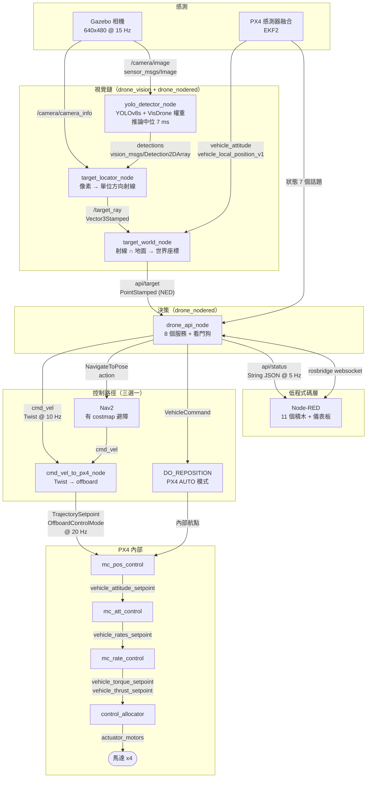
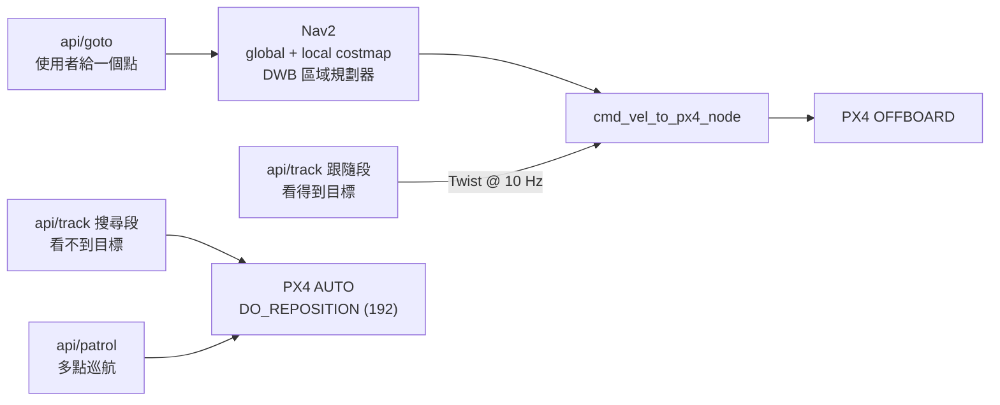
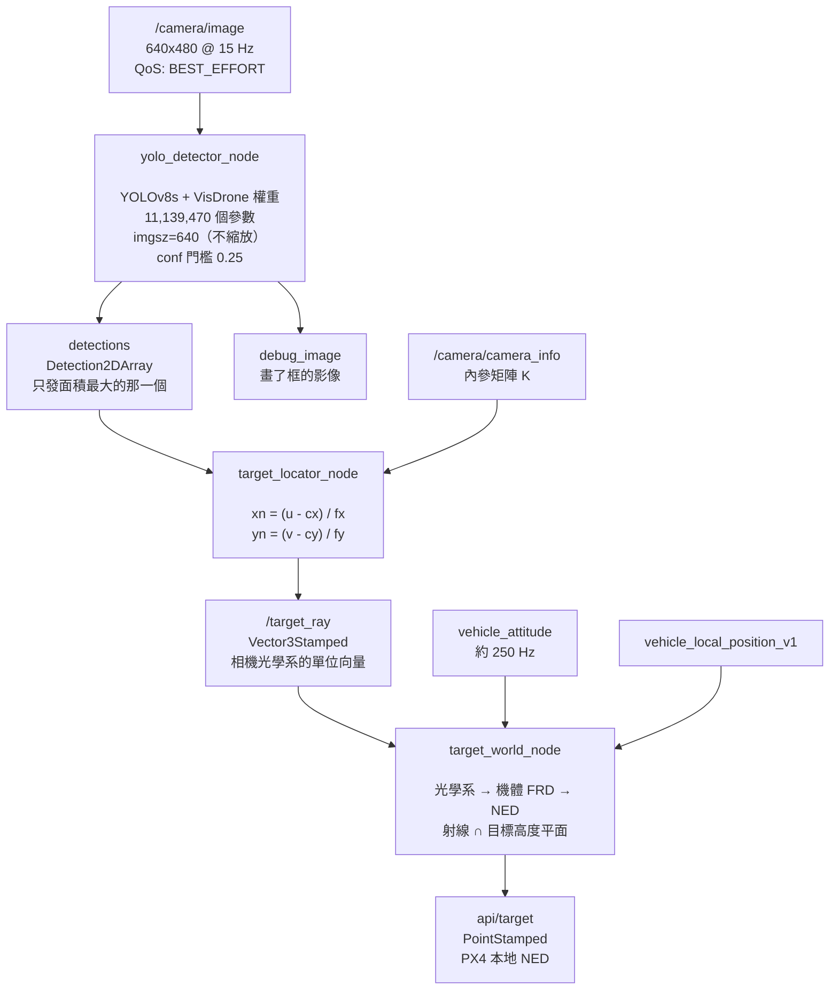
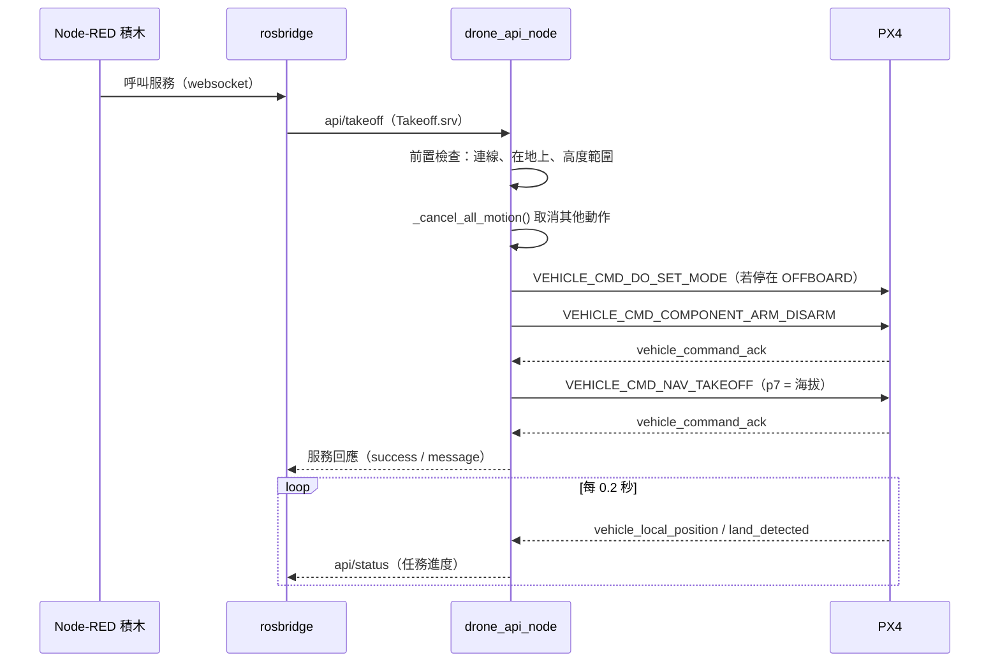
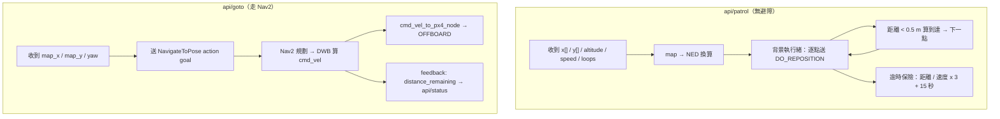
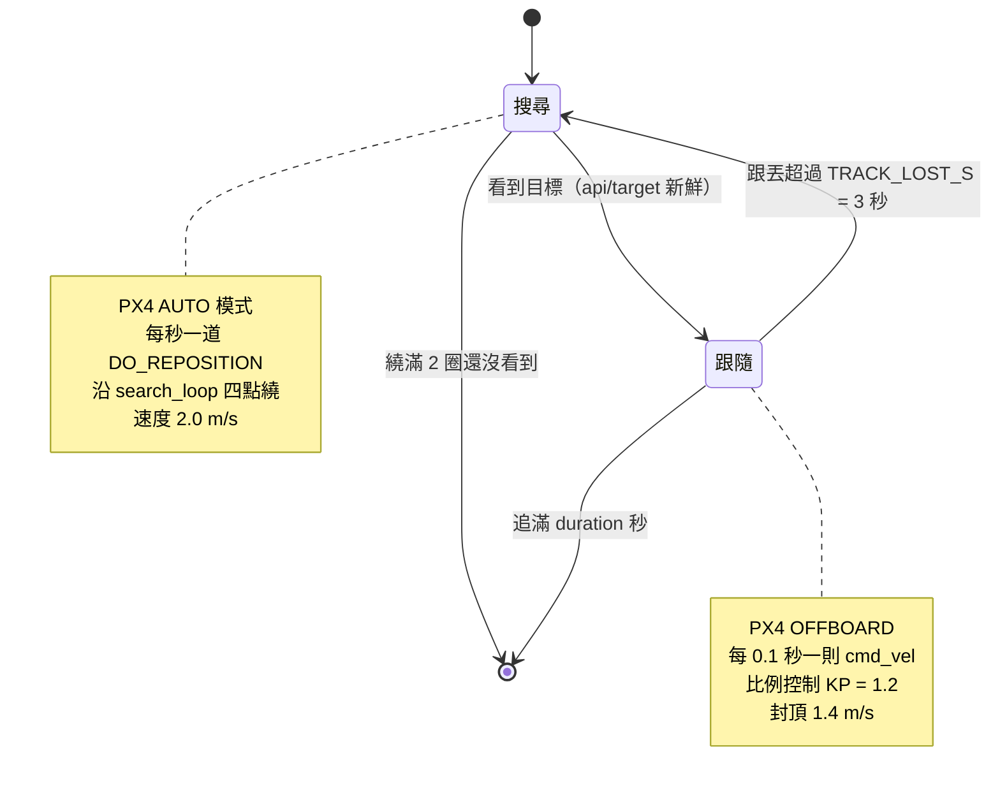
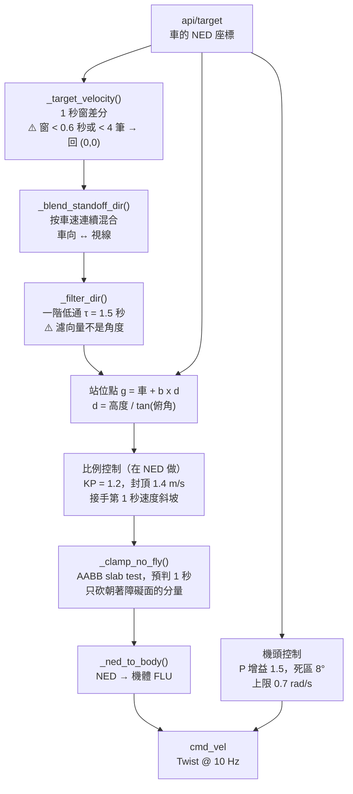
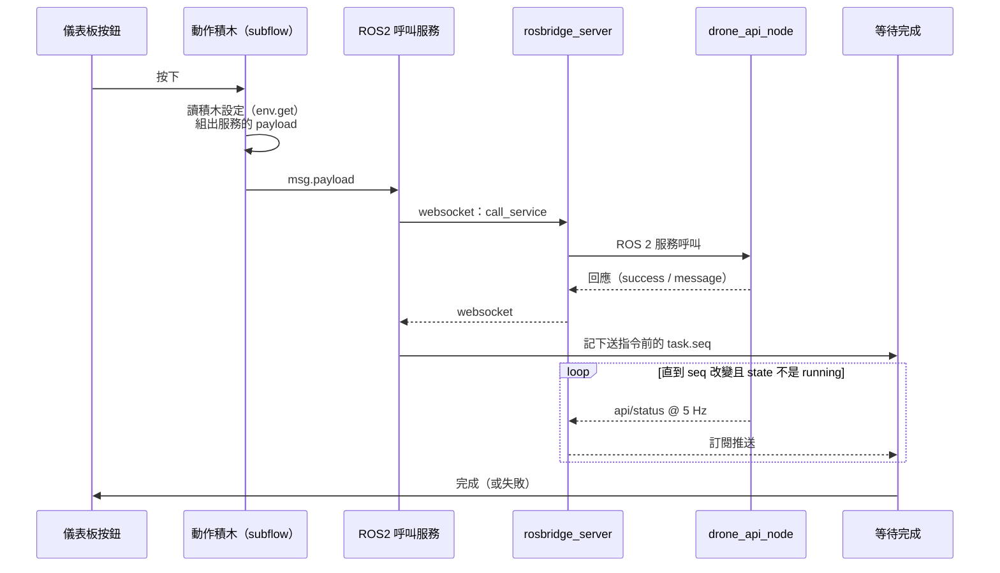
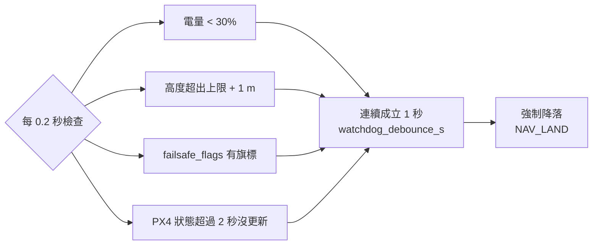

# 訊息流程：從感測到馬達

本文件說明 low-code 這一整層的資料怎麼走 —— 從相機和 PX4 的感測訊息，
經過哪些節點、做了什麼處理，最後怎麼變成馬達轉速。

> **怎麼維護這份文件**
> 圖都是 Mermaid 原始碼，在 GitHub 上會自動算繪。改程式之後請連這裡一起改 ——
> 所有節點名、話題名、訊息型別、參數值都是從原始碼查證過的，不是憑印象寫的。
> 需要 PNG 貼投影片的話，`docs/render_flow.sh` 可以把每張圖轉出來。

---

## 0. 一句話版本

```
相機 / PX4 感測  →  視覺鏈算出「車在世界的哪裡」  →  drone_api_node 決定要怎麼飛
                 →  三條控制路徑之一  →  PX4 四層串接控制器  →  馬達
```

**三條控制路徑是整份文件最重要的概念**，第 3 節有完整對照。

---

## 1. 總覽



**這張圖要看懂三件事**

1. **視覺鏈不碰飛控**。它只負責把「畫面上的框」變成「世界座標的一個點」，
   算完丟進 `api/target` 就結束。要換成地面車或機械手臂，這三個節點原封不動。
2. **只有 `drone_api_node` 會下命令**。所有控制權的互斥都收在它裡面一個節流點，
   不會有兩個東西同時在推飛機。
3. **PX4 內部那四層不是我們寫的**。我們最深只到 `TrajectorySetpoint`
   （位置／速度設定點），再往下是 PX4 的串接控制器。

---

## 2. 感測輸入清單

### 2.1 PX4 → ROS 2（uXRCE-DDS）

> ⚠️ 全部是 **BEST_EFFORT**。用預設的 RELIABLE 訂閱會**完全收不到而且不報錯**。

| 話題（`/MAV1/fmu/out/` 底下） | 型別 | 誰在用 | 用來做什麼 |
| --- | --- | --- | --- |
| `vehicle_local_position_v1` | VehicleLocalPosition | api、target_world | x/y/z、vx/vy、heading、`xy_valid` |
| `vehicle_attitude` | VehicleAttitude | target_world | 四元數，射線轉世界座標用 |
| `vehicle_status_v1` | VehicleStatus | api | `nav_state`（飛行模式）、`arming_state` |
| `vehicle_land_detected` | VehicleLandDetected | api | 在地上還是在空中 |
| `vehicle_global_position` | VehicleGlobalPosition | api | 海拔（起飛高度要給 AMSL） |
| `battery_status_v1` | BatteryStatus | api | 看門狗的低電量判定 |
| `failsafe_flags` | FailsafeFlags | api | 看門狗 |
| `vehicle_command_ack` | VehicleCommandAck | api | 指令有沒有被接受 |

**版本後綴 `_v1` 的規則**：由 `.msg` 的 `MESSAGE_VERSION` 決定，非 0 才有。
目前 `VehicleStatus` 和 `VehicleLocalPosition` 是 1，其餘是 0。訂閱錯名字 = 收不到。

### 2.2 相機 → ROS 2（ros_gz_bridge）

| 話題 | 型別 | 規格 |
| --- | --- | --- |
| `/camera/image` | sensor_msgs/Image | 640 x 480，15 Hz（每 66.7 ms 一張） |
| `/camera/camera_info` | sensor_msgs/CameraInfo | 內參矩陣 K，反投影用 |
| `/depth/image` | sensor_msgs/Image | ⚠️ 模擬的深度只有上 1/3 有值，**實際沒在用** |

> ⚠️ 相機影像的 `header.stamp` 是 **Gazebo 的模擬時間**，不是牆鐘。
> 這件事在 `target_world_node` 做姿態時間對齊時很關鍵（見 4.3）。

---

## 3. 三條控制路徑

這是整個系統最容易講錯的地方。**追蹤從來沒有用過 Nav2。**



| | `api/goto` | `track` 搜尋段 | `track` 跟隨段 | `api/patrol` |
| --- | --- | --- | --- | --- |
| 誰算路徑 | **Nav2** | 無（直線） | 無（直線） | 無（直線） |
| 送什麼 | `cmd_vel` → bridge | `DO_REPOSITION` | `cmd_vel` → bridge | `DO_REPOSITION` |
| PX4 模式 | OFFBOARD | AUTO | OFFBOARD | AUTO |
| **有避障嗎** | ✅ costmap + 膨脹層 | ❌ | ❌ | ❌ |
| 速度上限 | 1.2 m/s（`max_vel_x`） | 2.0 m/s | 1.4 m/s，bridge 再夾到 1.5 | 參數帶入 |
| 控制型態 | 速度 | **位置**（飛到點然後停） | 速度 | **位置** |
| 到達判定 | `xy_goal_tolerance` 0.4 m | `PATROL_ARRIVE_M` 0.5 m | 沒有「到達」 | 0.5 m |

### 為什麼沒有避障的那兩條是安全的

- **`patrol` / `track` 搜尋段**：飛的是**手挑、而且程式驗過**的航點
  （`gen_warehouse.py` 的自我檢查會確認每一段直線離障礙物 ≥ 0.5 m）。
- **`track` 跟隨段**：🔴 **不安全**，2026-10-19 撞過貨架。
  現在靠 `_clamp_no_fly` 的**禁飛方框**當硬性下限（見 5.3）。

### cmd_vel 橋做什麼

| 參數 | 模擬 | 實機 | 說明 |
| --- | --- | --- | --- |
| `publish_rate_hz` | 20.0 | 20.0 | 往 PX4 灌 setpoint 的頻率 |
| `max_speed_xy` | 1.5 | 0.5 | 再夾一次速度，室內刻意壓低 |
| `cmd_timeout_s` | 0.5 | 0.5 | 這麼久沒收到 cmd_vel 就放手 |
| `hold_on_timeout` | false | **true** | 室內逾時要原地保持，不然會掉下來 |
| `flight_altitude` | launch 帶入 | launch 帶入 | cmd_vel 沒有高度維度，定高由它負責 |

> ⚠️ `ensureOffboard()`：只要 `cmd_timeout_s` 內收到過 cmd_vel，它就會主動送
> `DO_SET_MODE` 把 PX4 拉回 OFFBOARD。所以**切回 AUTO 之前必須先停送並等逾時**，
> 否則 AUTO 和 OFFBOARD 會互搶，而且不會有任何錯誤訊息。

---

## 4. 視覺鏈（AI 分析感測的那一段）



### 4.1 YOLO 這一段做了什麼

**輸入**是影像，**輸出**是「框 + 每個類別的分數」—— 不是「特徵」。

- **框**：`cv2` 分支，4 條邊各 16 格的距離分佈（DFL），共 64 個數字
- **分數**：`cv3` 分支，10 個類別各一個 **sigmoid**（VisDrone 的類別集）
- 🔴 **YOLOv8 沒有 objectness 分支**（v5 以前才有）。類別分數本身就是信心值，
  所以 `car 0.000` 和 `cell phone 0.483` 可以同時成立 —— 它們是獨立的 sigmoid，
  不是加起來等於 1 的 softmax。

| 參數 | 值 | 理由 |
| --- | --- | --- |
| `imgsz` | 640 | 相機長邊剛好 640 → **縮放倍率 1.0，完全不縮** |
| `confidence` | 0.25 | 低於這個分數在 NMS 之前就丟掉 |
| `vehicle_classes` | car,van,truck,bus | 不要求分對車型，只要知道「那裡有一台載具」 |
| 選哪一個框 | **面積最大** | ≈ 最近的那台。不是信心最高（那可能是遠處剛好拍得清楚的） |

**效能**：推論中位 7 ms，相機每 66.7 ms 一張 → 只用掉 11% 的預算。

### 4.2 為什麼需要兩次座標換算

```
畫面像素 (u, v)
  │  用 RGB 內參反投影：xn = (u - cx) / fx
  ▼
相機光學系的單位方向（x 右、y 下、z 前）
  │  繞 y 軸轉「相機安裝俯角」→ 機體 FLU → FRD（y、z 反向）
  ▼
機體 FRD 的方向
  │  用 PX4 的**完整四元數**旋轉（不是只有機頭角）
  ▼
世界 NED 的方向
  │  和「目標高度的水平面」交會：t = (plane_z - oz) / nz
  ▼
目標的 NED 座標
```

> ⚠️ 只用機頭角、假設飛機水平是不夠的：追蹤時飛機為了加速會前傾好幾度，
> **每傾 1 度，3 公尺高算出來的地面點就差約 5 公分**。
> ⚠️ 相機不在機體原點上（往前 0.12 m、往下 −0.18 m），射線起點要跟著移。

### 4.3 🔴 姿態要取「拍這張影像那一刻」的

舊版用**最新**姿態配上 0.1~0.2 秒前的影像。飛機不動沒差，追蹤時差很多：

```
5 公尺高、姿態差 12°  →  算出來的地面點假性位移 5 x tan(12°) = 1.06 m
```

而飛機會去追那個假位移 → 更多橫滾 → 更大的假位移。**這是正回饋**，
2026-10-19 量到的症狀是跟隨時左右搖擺，橫向速度指令峰值 0.70 m/s。

現在存一秒的姿態環形緩衝（250 筆），按影像的 `header.stamp` 用 **nlerp** 內插。

> ⚠️ 內插前要確認兩個四元數在同一半球：`q` 和 `−q` 是同一個旋轉，
> 符號相反時直接內插會繞遠路轉過大半圈。
> ⚠️ 影像時戳（Gazebo 模擬時間）和 PX4 的 `timestamp`（hrt）在 SITL 同源，
> **實機不同源**。差值超出 ±0.5 秒就退回「用最新姿態」並警告一次。

---

## 5. 各任務的訊息流

### 5.1 起飛 / 降落 / 盤旋 / 調整高度

這四個的骨架一樣：**送一道 `VehicleCommand`，然後輪詢狀態等它完成**。



| 動作 | 送的 `VehicleCommand` | 完成判定 | 逾時 |
| --- | --- | --- | --- |
| `takeoff` | `ARM` + `NAV_TAKEOFF` | 高度到達目標 | 60 秒 |
| `land` | `NAV_LAND` | `land_detected` 且上鎖 | — |
| `hover` | `DO_SET_MODE`（AUTO_LOITER） | 送出就算完成 | 5 秒 |
| `set_altitude` | `DO_REPOSITION`（只改 p7） | 高度到達 | 依高度差 |

> 🔴 **起飛前要先切 AUTO_LOITER**。PX4 在 AUTO_LAND 落地上鎖時會把模式退回
> 「上一個被明確指定的模式」，追蹤期間 bridge 送過 OFFBOARD → 退回 OFFBOARD。
> 而在 OFFBOARD 解鎖要求有人正在串流 setpoint，橋早就放手了，
> 所以會一直回 `TEMPORARILY_REJECTED`，而且 goto/track/land 連帶全部拒絕。

### 5.2 巡航 `api/patrol` 與導航 `api/goto`



| | `patrol` | `goto` |
| --- | --- | --- |
| 座標系 | 離起飛點的 NED | **map 座標** |
| `yaw` | 沿行進方向 | 可指定，NaN = 不在乎 |
| 逾時 | 算出來的 | `goto_timeout_s` 120 秒 |
| 失敗模式 | 直線撞障礙物 | Nav2 規劃不出路徑 |

> ⚠️ `yaw` 用 NaN 表示「不在乎朝向」，但 **rosbridge 不能帶 NaN 給浮點欄位**。
> Node-RED 那側用 `|yaw| > pi` 代表同一件事，節點收到後轉成 NaN。

### 5.3 追蹤 `api/track`（最複雜的一個）



**跟隨段的完整訊號流**（這是控制器設計的核心）



| 環節 | 常數 | 治什麼 |
| --- | --- | --- |
| 速度估計門檻 | `TRACK_VEL_MIN_WINDOW_S` 0.6 s、`MIN_SAMPLES` 4 | 剛鎖定時資料不足就不猜方向 |
| 方向混合 | `TRACK_MIN_TARGET_SPEED` 0.15 m/s | 門檻上的硬切換會讓站位點瞬移 4.24 m |
| 方向低通 | `TRACK_DIR_TAU_S` 1.5 s | ±13° 翻邊 → 橫向指令 0.70 降到 0.23 m/s |
| 速度斜坡 | `TRACK_HANDOFF_RAMP_S` 1.0 s | 接手時不要從 3.2 m/s 硬煞 |
| 禁飛方框 | `no_fly_margin_m` 0.8、`lookahead` 1.0 s | **唯一的硬性保險**，擋靜態障礙物 |

> 🔴 **禁飛方框不是避障系統**。它只知道設定檔裡那 8 個方框
> （4 排貨架 + 4 面外牆內緣），目標車、別的飛機、臨時生成的模型都不在裡面。

---

## 6. 低程式碼層怎麼接上



| 積木 | 對應服務 | 可設定的欄位 |
| --- | --- | --- |
| 起飛 | `api/takeoff` | 高度 |
| 盤旋 / 降落 / 狀態查詢 | `api/hover` `api/land` `api/state` | 無 |
| 調整高度 | `api/set_altitude` | 高度 |
| 巡航 | `api/patrol` | x[]、y[]、高度、速度、圈數 |
| 導航到座標 | `api/goto` | map_x、map_y、yaw |
| 追蹤目標 | `api/track` | 距離、高度、秒數、搜尋環線 x[]/y[] |

> ⚠️ 新增自訂訊息型別之後，**rosbridge 也要重新 source 才認得**，
> 不然呼叫會失敗而且錯誤訊息看不出原因。

### 儀表板顯示什麼

`api/status`（`std_msgs/String`，內容是 JSON，5 Hz）一包帶走所有東西：

| 欄位 | 用在哪 |
| --- | --- |
| `ready`（px4 / position / nav2 / bridge） | 就緒燈。**刻意不含視覺偵測** |
| `altitude_m`、`speed_mps` | 高度表、水平速度表 |
| `map_x` / `map_y` / `map_heading_deg` | 地圖上的無人機位置 |
| `scene.boxes` | 地圖的場地幾何（貨架 + 外牆） |
| `task`、`patrol`、`track`、`nav` | 任務進度文字 |
| `watchdog` | 看門狗有沒有跳 |

> ⚠️ 位置給的是 **map 座標**，由節點換算好才送出去。
> 前端不做任何座標換算 —— 兩邊各算一次而且不一致是這個專案踩最多次的雷。

---

## 7. 看門狗（唯一會自己動的東西）



防抖 1 秒是為了避開瞬間雜訊 —— 誤觸發最多是提早降落，漏掉才危險。

---

## 8. 常見誤解速查

| 誤解 | 實際 |
| --- | --- |
| 「追蹤用 Nav2 避障」 | ❌ 追蹤**從來沒有**用過 Nav2。靠禁飛方框當下限 |
| 「YOLO 會輸出特徵」 | ❌ 輸出是「框 + 每類分數」，特徵是網路內部的中間結果 |
| 「信心 0.92 = 92% 正確」 | ❌ 不是校準過的機率。只能當門檻和相對比較 |
| 「我們用 VisDrone 訓練模型」 | ❌ 我們**沒有訓練任何東西**，用的是社群訓練好的權重 |
| 「影像會被縮小丟給 YOLO」 | ❌ 相機長邊剛好 640 = `imgsz`，縮放倍率 1.0 |
| 「改了 flow 檔重啟服務就生效」 | ❌ Node-RED 跑的是 `~/.node-red/flows.json`，要跑 `install_flows.sh` |

---

## 9. 相關文件

- `docs/warehouse_runbook.md` — 倉庫場景的操作手冊
- `README.md` — 套件總覽與啟動方式
- `config/warehouse_geometry.yaml` — 場地幾何的**單一來源**（`gen_warehouse.py` 產生）
