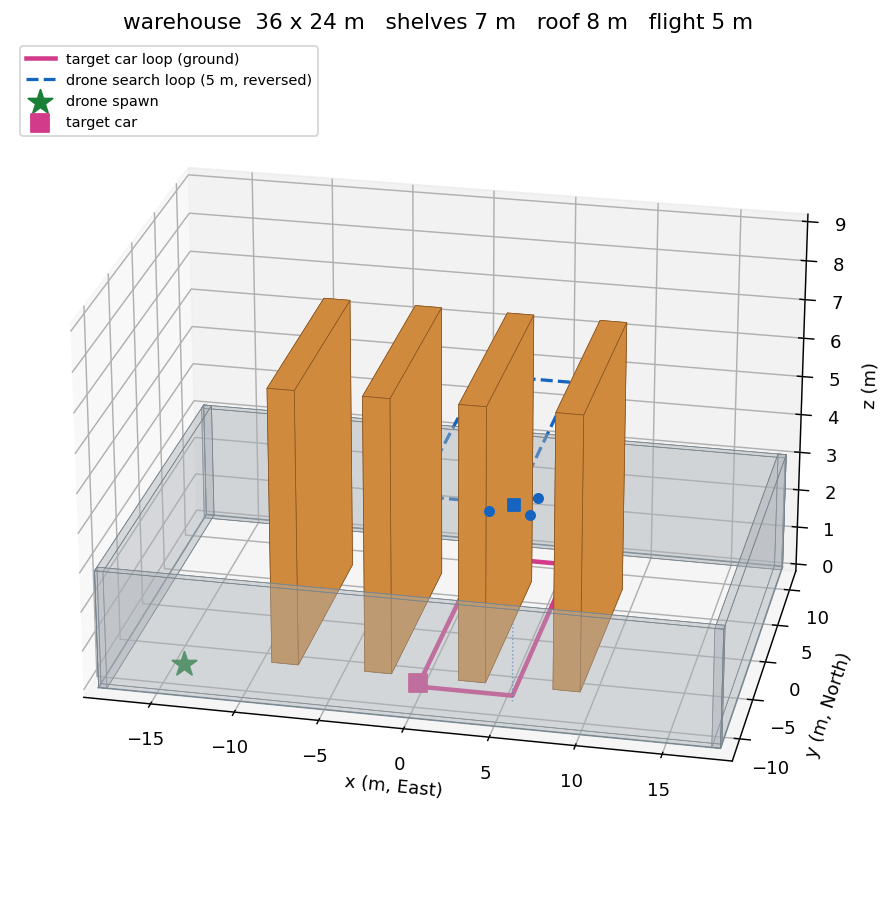
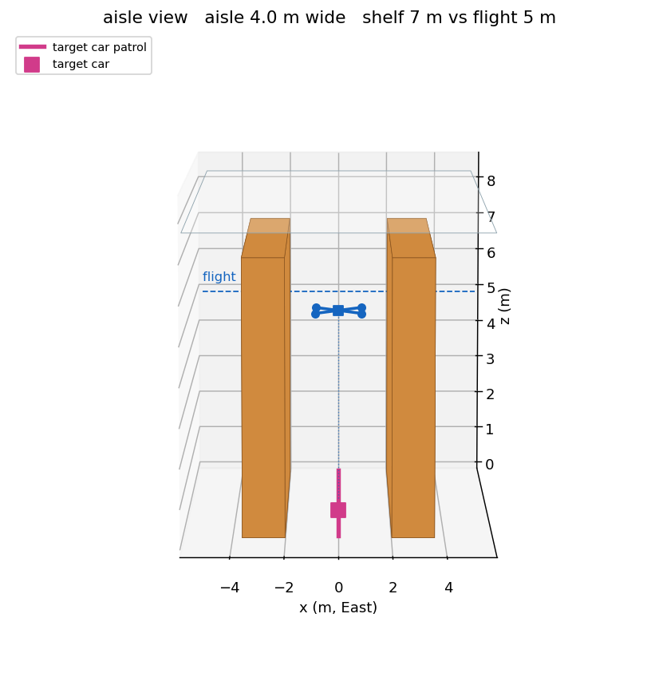
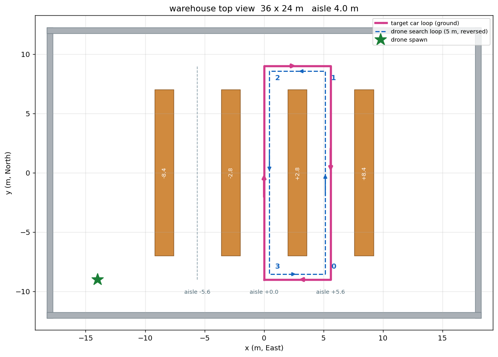

# 倉庫場景操作手冊

## 場景長什麼樣子

| 圖 | 看什麼 |
| --- | --- |
|  | 整座倉庫：四排 7 m 貨架、5 m 的飛行高度、車和飛機的環線 |
|  | 走道的高度關係：貨架 7 m vs 飛機 5 m vs 屋頂 8 m |
|  | 和 Nav2 讀的地圖同一個視角，兩條環線的**方向相反**（箭頭） |

這三張是 `scripts/render_warehouse.py` 從 `gen_warehouse.py` 的幾何直接畫的，
不是 Gazebo 截圖 —— 改了場景重跑那支就會更新，不會和世界檔脫節。
（`warehouse_preview.png` 是 `gen_warehouse.py` 自己附帶的那張舊俯視圖，留著。）

## 一行啟動

```bash
ros2 launch drone_nodered warehouse_all.launch.py
```

起來之後飛機還在地上（在西南角 `-14, -9`）。起飛：

```bash
ros2 run drone_control arm_and_takeoff.py --ns MAV1 --altitude 3.0
```

然後在 RViz 用「2D Goal Pose」點走道，或用 action 給點：

```bash
ros2 action send_goal /navigate_to_pose nav2_msgs/action/NavigateToPose \
  "{pose: {header: {frame_id: map}, pose: {position: {x: 0.0, y: 0.0}, orientation: {w: 1.0}}}}"
```

**關掉：在那個終端機按 Ctrl-C。** 不要用 `kill`（原因見下面「關機」）。

### 可以調的參數

| 參數 | 預設 | 說明 |
|---|---|---|
| `headless` | `false` | `true` = 不開 Gazebo 視窗（RViz 還是會開） |
| `rviz` | `true` | |
| `target` | `true` | 中間走道的車會南北巡迴。`false` = 車靜止（**不會消失**，它是世界檔 include 的） |
| `vision` | `false` | x500 沒有相機。要用得先把 launch 裡的 `MODEL` 換成 `x500_cam_down` |
| `api` | `true` | `drone_api_node`。單純手測 Nav2 可以 `api:=false` |
| `altitude` | `3.0` | 貨架高 5 m，不要超過 |

**`params_file` / `map` / `odom_origin` / `use_sim_time` 刻意不開放。**
它們必須互相一致，開放成參數就等於把三個靜默失敗放回來（見
`warehouse_all.launch.py` 檔頭）。

## 場地幾何

```
  y
  ↑   ┌─────────────────────────────────────┐  y=+12 北牆
      │   ███   ███   ███   ███             │
      │   ███   ███   ███   ███             │  貨架 y ∈ [-7, +7]
      │   ███   ███   ███   ███             │  高 5 m（飛不過去）
      │                                     │
  ────┼─────────────────────────────────────┼──→ x
      │   ███   ███   ███   ███             │
      │   ███   ███   ███   ███             │
      │ ★ ███   ███   ███   ███             │  ★ = 生成點 (-14, -9)
      └─────────────────────────────────────┘  y=-12 南牆
     x=-18                                x=+18

  貨架中心 x： -8.4  -2.8  +2.8  +8.4      （不可通行）
  走道中心 x： -5.6   0.0  +5.6             （可通行，寬 4 m）
```

數字的唯一來源是 `scripts/gen_warehouse.py`，它會產生
`config/warehouse_geometry.yaml` 給 launch 和 shell 腳本讀。
**改場景就改那支再重跑**，不要手改產生出來的檔。

`(-14,-9)` 到 `(0,0)` 的直線在 x=-9.2 時 y≈-5.9，正好穿過第一排貨架 ——
這就是「Nav2 真的有用」而不是裝飾的理由。

## 關機：三種訊號的實測結果

2026-10-07 實測，三種都跑到堆疊完全起來才下訊號：

| 怎麼關 | 行程 12→? | launch 退出 | 節點優雅關閉 | 評語 |
|---|---|---|---|---|
| **終端機按 Ctrl-C** | **12 → 0**（< 3 秒） | ✅ | ✅ | **正確做法** |
| `systemctl stop`（群組 SIGTERM） | 12 → 0（< 5 秒） | ✅ | ❌ 硬殺 | 可接受，L5 用這條 |
| `kill -INT <launch的PID>` | 12 → 12 | ❌ | ❌ | **完全沒反應** |
| 群組 SIGINT（非終端機） | 12 → 1 | ❌ 卡住 | ✅ | agent 留著佔住 8888 埠 |

### 為什麼 `kill -INT <PID>` 沒用

`ros2 launch`（Humble）只有在**有控制終端**時才會對 SIGINT 反應。
有終端時它會印：

```
^C[WARNING] [launch]: user interrupted with ctrl-c (SIGINT)
```

然後才去逐一處理子行程。沒有終端時它收到 SIGINT 不做任何事，
所以子行程只會收到核心直接送的那一個訊號，自己能不能處理就看它自己。

`MicroXRCEAgent` 就是那個「自己處理不了」的 ——
它在那條路徑上不理 SIGINT（但**吃 SIGTERM**）。它活著 launch 就不會退出，
而 8888 埠被佔住會讓下一次啟動失敗。

### ⚠️ 不要把 systemd unit 改成 `KillSignal=SIGINT`

看起來很合理（「讓它優雅關機」），但 systemd 底下**沒有控制終端**，
所以那會變成表格最後一列：agent 卡住、launch 不退出、硬等
`TimeoutStopSec=45` 才被 SIGKILL —— 比現在的預設更糟。

`drone-sim.service.in` 現在用 systemd 預設的 `KillMode=control-group`
＋ SIGTERM，那是實測過最乾淨的那條（第二列）。**不要動。**

## 封存的空白世界（2026-10-12 退休）

舊的空白世界（`drone-sim.service`、`gz/worlds/empty.sdf`／`empty_target.sdf`）
不再預設安裝 —— Node-RED 的「系統」分頁只留一組按鈕，名稱是「開模擬」，
指向 `drone-warehouse.service`。

**東西都還在，要叫回來三行：**

```bash
# ① 裝服務
bash src/drone_nodered/scripts/install_services.sh --with-empty-sim
# ② 重新產生流程（按鈕是寫在產生出來的 JSON 裡，install_flows.sh 不會自己重跑產生器）
python3 src/drone_nodered/nodered/make_drone_basic.py --with-empty-sim
# ③ 更新 Node-RED
bash src/drone_nodered/scripts/install_flows.sh
```

「系統」分頁會多出「開空白世界／關空白世界／空白世界狀態／看空白世界 log」四顆
（明確命名的是封存的那個，因為「模擬」已經是倉庫的名字）。
兩個場景設了 `Conflicts=`，systemd 會自動停掉另一個。

要再退休回去就把兩個 `--with-empty-sim` 拿掉重跑同樣三行
——`install_services.sh` 會主動把 `drone-sim.service` 清掉。

**沒有退休、不能動的東西**（倉庫在用它們）：

| 檔案 | 為什麼不能退休 |
|---|---|
| `launch/sim_all.launch.py` | `warehouse_all` 用它開 Gazebo＋PX4＋agent |
| `scripts/start_empty_sitl.sh` | 同上（名字有 empty 但它吃 `WORLD` 環境變數） |
| `gz/models/magenta_target` | 倉庫的目標車也是這個模型 |

`sim_all.launch.py` 的 `world` 預設值刻意維持 `empty_target`，不改成 `warehouse`
—— 那個預設只影響「單獨跑 `sim_all`」，正是封存路徑的入口。
`warehouse_all` 一律明確傳 `world:=warehouse`，不依賴那個預設。

## 踩雷排除

### `ros2 node list` 吐 traceback 或回空白，但一切其實正常

```
xmlrpc.client.Fault: <Fault 1: "<class 'RuntimeError'>:!rclpy.ok()">
```

`ros2 daemon` 自己掛了 —— 它的 rclpy context 已經關閉，但 XMLRPC socket
還在聽，所以不是「連不上」而是「連上了，對方是殭屍」。

`ros2 node list` 和 `ros2 param get` 預設走守護行程；`tf2_echo`、
action client、節點本身都不走，所以**只有這幾個 CLI 會壞，飛行完全正常**。

```bash
ros2 daemon stop          # 下次 CLI 呼叫會自動重開一個
# 或者一律加
ros2 node list --no-daemon
ros2 param get --no-daemon /bt_navigator default_server_timeout
```

寫測試腳本時建議一律加 `--no-daemon` —— 否則守護行程一掛，
測試會回報「節點不存在」這種假失敗。

### Nav2 卡在「Configuring map_server」→ `api/goto` 說「Nav2 沒有在跑」

```
map_server:         configure 完成（16 ms 就讀完地圖）
                    failed to send response to /map_server/change_state (timeout):
                    client will not receive response, at ./src/rmw_response.cpp:154
lifecycle_manager:  Configuring map_server → 永遠卡在這裡
→ bt_navigator 沒被 configure → /navigate_to_pose 不存在
→ api/goto 回「Nav2 沒有在跑（/navigate_to_pose 找不到）」
```

**不是 CPU 逾時**（整個過程只花 120 ms）。`lifecycle_manager` 一建完 service
client 就立刻呼叫 `change_state`，`map_server` 收到並處理完了，但**回應送不回去**
—— 它還沒探索到那個 client 的 reader。

**觸發條件是「Nav2 bringup 進行中有新節點加入」**（2026-10-10 實測）：

| 做法 | 結果 |
|---|---|
| 先開倉庫、63 秒後才開 `drone_api` | ❌ 卡住 |
| 單獨開倉庫（含 `vision:=true`）× 3 | ✅ 3/3 |
| 先開 `drone_api`、再開倉庫 | ✅ |

所以 **`drone-nodered.service` 必須先起來**。`drone-warehouse.service` 設了
`Wants=` ＋ `After=drone-nodered.service`，按「開倉庫」會自動把底座拉起來。

手動啟動時自己注意順序：**底座（或 `drone_api`）先、倉庫後**。
卡住的判定法：

```bash
# 要有 1
systemctl --user show -p ExecMainStatus drone-warehouse.service
journalctl --user -u drone-warehouse.service | grep -c "Managed nodes are active"
# 或手動啟動時
ros2 action list | grep navigate_to_pose
```

⚠️ 等「堆疊就緒」**不等於** Nav2 可用 —— 那行是 launch 自己印的，
Nav2 的生命週期還要再 20~30 秒。要等的是 `Managed nodes are active`。

**平常不用查 log**：2026-10-12 起儀表板左上有就緒燈（`api/status` 的 `ready` 欄位，
`drone_api_node._ready()`），四項全到才顯示「✅ 就緒」：

| 項目 | 怎麼判定 | 少了它的症狀 |
| --- | --- | --- |
| `px4` | 2 秒內收到過 `vehicle_status` | 所有指令被拒 |
| `position` | `vehicle_local_position.xy_valid` | 連盤旋都不行 |
| `nav2` | `/navigate_to_pose` 的 action server 在 | 「導航到座標」被拒 |
| `bridge` | `/MAV1/cmd_vel` 有訂閱者 | **Nav2 規劃成功、狀態顯示「導航中」，飛機不動也不報錯** |

就緒燈**刻意不含視覺偵測** —— 「偵測節點在跑」和「現在看得到車」是兩回事。

### 儀表板的地圖怎麼看

中間那張圖是即時的場地俯視（2026-10-20 加，座標都由 `drone_api_node` 換算好才
送出來，前端不做任何座標運算）：

| 畫面上的東西 | 是什麼 | 看它要幹什麼 |
| --- | --- | --- |
| 藍色三角形 | 無人機，尖端是機頭 | 現在飛到哪、朝哪 |
| ⭕ 紅色空心圈 | 車的**出生點**（世界檔設定的，不是看到的） | 控制台一開就有，讓你知道「車本來在哪」 |
| 🔴 紅點 | **YOLO 認為**車在哪（不是 Gazebo 真值） | 它和三角形的相對位置**就是追蹤誤差** |
| 紅色虛線 | 無人機 ↔ 車 | 現在的站位距離（該收斂到 `高度 / tan(俯角)`） |
| 灰點（原本是紅點） | 超過 3 秒沒看到了 | 這是**最後一次看到的位置**，不是現在的位置 |
| 藍色虛線框 + 小圓點 | 搜尋環線（`search_x/y`） | 追蹤時才出現 |
| 其中一個實心大圓點 | 現在正飛去這個航點 | **它不動就是沒在巡航** |
| 橘色方塊 | 貨架 | 禁飛方框就是照這個產生的 |

🔴 **空心圈 vs 實心點**：空心＝設定值（還沒看到車），實心＝真的偵測到了。
一旦偵測過，空心圈就不再出現 —— 連跟丟後那個灰點都比設定值有用（它至少是
真的看過的位置）。所以**空心圈還在 = 從開機到現在一次都沒看到車**。
⚠️ 車開走之後空心圈不會跟著動（它只是設定值）。

🔴 **紅點凍住 + 環線高亮點不動 = 飛機沒在巡航**。2026-10-20 那次「它沒有去巡航
找車」就是這個狀態，而當時儀表板上沒有環線也沒有紅點，所以完全看不出來。
現在搭配節點 log 裡每 2 秒一行的搜尋診斷（含**當下的 PX4 模式**），
「模式是 OFFBOARD 而且不動」就是控制權被搶走的指紋。

### 寫測試腳本時會互相殺掉（我和你同時在跑）

有**兩個**入口會殺掉正在跑的堆疊：

| 在哪 | 做什麼 |
|---|---|
| `start_empty_sitl.sh:269-271` | 啟動時 `pkill -x px4` ＋ `pkill -f "gz sim"` —— 它分辨不出「上一輪的殘留」和「別人正在跑的」 |
| 測試腳本收尾 | 很寬的 `pgrep` 模式 ＋ `kill -KILL` |

2026-10-08 兩個都中過。後果不只是視窗黑掉：兩套堆疊共存時
**兩個 `drone_api_node` 都在提供 `/MAV1/api/*`**，手動按的起飛會落到另一套的節點上，
而且兩套 Gazebo／PX4／Nav2 搶 CPU，那一輪的測量全部不可信。

寫測試腳本時在開頭 source `test/tools/guard.sh` 並呼叫 `guard_or_die` ——
發現有東西在跑就中止，不要碰。

⚠️ **`pkill -f` 會配到自己的命令列，連 heredoc 的內容也算。**
把腳本寫成檔案不夠 —— 「寫入檔案那道命令」本身也在命令列裡。
所以**命令列裡不要出現 `gz sim`、`px4_sitl` 這些字串**，
要嘛放進已存在的檔案、要嘛用 python 組字串。

### 量飛機位置不要用 `gz model -p`

`gz model -m <模型> -p | grep -A1 'Pose \[' | tail -1` 對**多連桿模型**會抓到錯的連桿
（`x500_cam_down` 有 base_link、四個旋翼、支架、相機共七個）。
2026-10-08 實測資料變成「2 秒內跳 18 公尺」的垃圾，而且不會報錯。

而且它的姿態輸出是**兩行**（XYZ 一行、RPY 下一行），`grep -A1` 只會拿到位置那行，
要機頭角得用 `-A2` 取第二行。

**用 `test/tools/watch_pose.py`**（訂 `/world/<世界>/dynamic_pose/info`）：

```bash
python3 src/drone_nodered/test/tools/watch_pose.py warehouse x500_cam_down_0 60 0.5
# 輸出：時間 x y z yaw
```

⚠️ 一定要連 **z** 一起記。2026-10-08 少了它，差點答不出
「飛機有沒有從貨架上面飛過去」這個問題。

### 「依 model 決定」的 launch 參數算出錯的值（而且不報錯）

把依 `model` 的判斷寫在 `IncludeLaunchDescription` 的 `launch_arguments` 裡會**算錯**：
`launch_arguments` 是有序的 `SetLaunchConfiguration` ＋ 延遲求值，而
`sim_all` 會把 `model` 改寫成 `<model>_0`（PX4 的實例編號），**改寫會外洩到外層**。
所以外層後面才求值的表達式讀到的是改寫後的值。

咬過兩次，症狀都是「看起來有設定但值是錯的」：

| 日期 | 哪裡 | 症狀 |
|---|---|---|
| 2026-10-06 | `sim_all` 的 `camera_pitch` | 俯角永遠報 45° 而不是 67° |
| 2026-10-08 | `warehouse_all` 的 `camera_pitch_deg` | `api/track` 的最佳跟隨距離算成 2.97 m 而不是 1.27 m → 下俯餘裕只剩 5.3°（加速要 5.8°）→ 一加速就追丟 |

**正解：凡是「依 model 決定」的值一律提到外層 `DeclareLaunchArgument`**，
在任何東西改寫 `model` 之前求值，include 裡只轉交不重算。

回歸測試（約 10 秒，不用開模擬）：

```bash
bash src/drone_nodered/test/t_launch_order.sh
```

它同時驗「壞寫法確實還會算錯」和「好寫法算對」—— 前者算對了反而要注意，
代表 launch 的求值行為變了，那些繞法和註解要重新檢視。

⚠️ 寫這類測試腳本時不要用 `set -u`：ROS 的 `setup.bash` 會讀
`AMENT_TRACE_SETUP_FILES` 這類未綁定的變數，`set -u` 下 source 它會直接失敗。

### 想從 `gz model -p` 取機頭角，結果永遠是空的

`gz model -m <名稱> -p` 的姿態輸出是**兩行**：

```
Pose [ XYZ (m) ] [ RPY (rad) ]:
[-14.00 -9.00 3.00]        ← 位置
[0.00 -0.02 1.57]          ← 姿態（roll pitch yaw）
```

所以常見的 `grep -A1 'Pose \[' | tail -1` 只會拿到**位置那一行**，
再 `awk '{print $6}'` 就是空字串，而且不會報錯 —— 只會在後面
「取樣 0 筆」的時候才發現。要姿態得用 `-A2` 並取第二行。

比較可靠的做法是訂 Gazebo 的姿態廣播（這個 topic 實測存在）：

```bash
gz topic -e -t /world/warehouse/dynamic_pose/info
```

`drone_nodered/scripts/move_target.py` 的 `PoseWatcher` 就是用它 ——
`--mode loop` 必須讀位置回授（計時誤差會累積，繞一圈就會開進貨架）。

### `api/patrol` 的航點送進貨架裡會怎樣

不會報錯，飛機會一路推到貨架邊然後卡住，直到節點自己的逾時保護觸發：

```
[patrol] 第 2/2 點：x=6.0 y=6.0
[任務] patrol → failed：飛到第 2 個點逾時（等了 27 秒）
```

**`api/patrol` 走的是點對點 `DO_REPOSITION`，PX4 直線飛過去、不看地圖、不避障。**
所以航點一定要事先驗證在空的走道裡 ——
`config/warehouse_geometry.yaml` 的 `target_loop` / `search_loop` 都過了
`gen_warehouse.py` 的自我檢查⑥（每一段離障礙 >= `robot_radius` 0.5 m）。
自己手打航點時記得 `Patrol.srv` 的座標是「**離起飛點的 NED**」（x 北、y 東），
不是 map 座標 —— 倉庫的起飛點在 map `(-14,-9)`，所以
`x=6, y=6` 其實是 map `(-8,-3)`，正好在貨架裡面。

### `ros2 topic echo /MAV1/api/status` 的 JSON 剖析失敗

```
json.decoder.JSONDecodeError: Expecting property name enclosed in double quotes: line 1 column 129
json.decoder.JSONDecodeError: Unterminated string starting at: line 1 column 128
```

**`ros2 topic echo` 預設會把長字串截斷成 `...`。** `api/status` 的 JSON 有
十幾個欄位，一定超過門檻，所以剖出來永遠是壞的 JSON（那個 `"...` 就是
「沒有結尾的屬性名」，正好對上 column 128/129）。

```bash
ros2 topic echo --full-length /MAV1/api/status --once
```

⚠️ 同一個陷阱在 `ros2 action send_goal` 上也有（長路徑會被截斷）。
**用 CLI 看任何可能很長的訊息時都要加 `--full-length`。**
真的要程式化讀取就不要剖 CLI 輸出，直接寫個 `rclpy` 訂閱者。

### `sequence size exceeds remaining buffer`

Fast DDS 的反序列化錯誤。單獨出現一次、而且東西都正常時可以忽略
（通常在新節點加入時）。如果伴隨**整個 Nav2 起不來**，那是 `/dev/shm`
留下了被 SIGKILL 掉的行程的殘骸：

```bash
rm -f /dev/shm/fastrtps_* /dev/shm/sem.fastrtps_*
```

這也是上面那個守護行程掛掉的可能肇因 —— 守護行程是存活最久、
看得到每一個 participant 的那個 participant，最容易被壞掉的 discovery 資料打死。

### 給點之後飛機不動／卡在某個目標

先確認參數檔真的接上了（這是最常見的原因）：

```bash
ros2 param get --no-daemon /bt_navigator default_server_timeout
```

要是 **20** 而不是 **200**，表示 `params_file` 沒接上、退回了 arena 那份舊參數。
20 毫秒會造成孤兒 goal 和無限的 `Aborting handle`，只能重開 Nav2。
用 `warehouse_all.launch.py` 啟動的話這個值是寫死的，不會錯；
手動開 `nav2.launch.py` 而忘記帶 `params_file` 就會中。
詳細原因見 `nav2_params_lineage.md`。

### 飛機飛到錯的地方，但 Nav2 說「成功」

生成點和 `odom_origin` 不一致，整張地圖平移了。檢查：

```bash
ros2 run tf2_ros tf2_echo map base_link     # 起飛前應該是 -14, -9
```

用 `warehouse_all.launch.py` 的話兩邊都讀 `config/warehouse_geometry.yaml`，
不會不一致。手動開才有這個風險。
